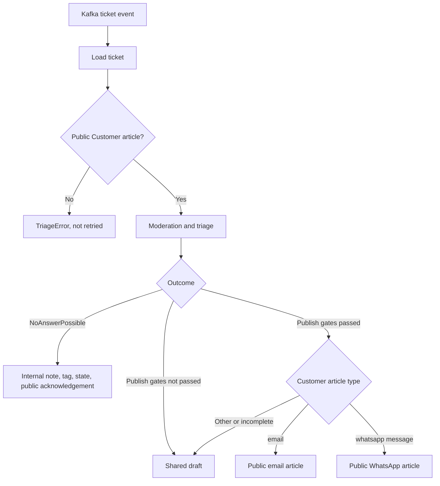

# Channel-Aware Replies

A public reply must go back through the channel the customer used. A bare Zammad article is stored as a `note`, which is visible in the ticket but never reaches the customer. The standard REST client therefore builds a channel-specific article for each reply.

## Flow

Kafka is the only ticket-event ingress. Events carry the ticket ID but no article ID, so the workflow loads the ticket and selects the newest public `Customer` article with `ZammadTicket.latest_customer_article()`. Triage reads that article, and the reply channel is resolved from the same selection when the answer is posted.

## Publish Gates

An answer is published only when both gates pass:

1. The triage category has `auto_publish: true`.
2. The answer is a `StaticAnswer`, or an `AnswerCandidate` with `auto_publish` set. Judge rejection and an unsafe response moderation result clear that flag.

Every other answer becomes a shared draft for an agent to review.

## Reply Payloads

| Customer article type | Article created | Addressing |
| --- | --- | --- |
| `email` | `type=email`, `sender=Agent`, `internal=false` | `from` and `to` are reversed from the customer article; `in_reply_to` uses its message ID |
| `whatsapp message` | `type=whatsapp message`, `sender=Agent`, `internal=false`, `text/plain` | None. Zammad reads the recipient from `ticket.preferences['whatsapp']['from']['phone_number']` |
| Anything else, or an email without a customer address | Shared draft | The system never substitutes another channel |

Creating an article means Zammad accepted it. It does not prove delivery by the mail server or Meta.

## Handoff

`NoAnswerPossible` runs a handoff that surfaces the ticket to agents and tells the customer it was received. The `human_review_*` settings apply when the category is the `no_category_name` or the action is `NoAction`. The `no_answer_*` settings apply otherwise.

1. Post the internal note (`human_review_internal_note` or `no_answer_internal_note`).
2. Add the tag (`human_review_tag` or `no_answer_tag`).
3. Set `handoff_ticket_state`, when configured.
4. Post the localized public acknowledgement (`human_review_public_fallback` or `no_answer_public_fallback`).

## Turns and Human Takeover

A ticket is a conversation, answered turn by turn (`app/conversation/turn.py`):

- **Turn:** the public customer messages after `ai_answered_through_article_id`, oldest first. Internal, Agent, System and web-form articles are never part of a turn.
- **Takeover:** the AI does not answer when a human agent replied publicly since its last answer, when a human agent owns the ticket (owner `1` means unassigned), or when the ticket carries a hand-off tag (`human_review_tag`, `no_answer_tag`, `failed_tag`).
- **Resume:** the tag in `conversation.resume_tag` (default `ai_resume`) hands the ticket back to the AI.

The AI tells its own articles from a human's by the service user's ID, from `GET /api/v1/users/me`. Only the REST client supports this.

### Answering a Turn

With `conversation.enabled` (the default; it requires `zammad.type: api`), a Kafka event only says that a ticket changed. The handler reloads the ticket and works out what it needs:

- **Nothing new** since the marker (a redelivered event, a later event of the same burst, or the AI's own reply): the event is acknowledged and nothing is posted.
- **A person owns the conversation:** nothing is posted.
- **Otherwise** the whole turn goes to triage and answering as one request. Several messages are sent as a numbered list, with a note that greetings are not the request when another message asks something.

Every outcome records the turn's newest article in `ai_answered_through_article_id`:

- A public answer or hand-off acknowledgement writes the reply and the marker in one `PUT /api/v1/tickets/{id}`, so a retry can never post it twice.
- A shared draft or a hand-off without an acknowledgement writes the marker on its own.

After the AI answers a ticket that carried the resume tag, it removes the tag, and the marker carries the conversation on.

With `conversation.enabled: false`, each event triages the newest customer message once, as before.

### Quiet Period

Customers often send several short messages in a row. A turn is answered only when its newest message is `conversation.quiet_seconds` old (default 10 s), and at the latest `conversation.max_wait_seconds` after its first message (default 60 s), even if the customer keeps writing. `quiet_seconds: 0` answers at once.

The Kafka handler never waits. If a turn isn't quiet yet, it acknowledges the event and schedules an in-process re-check of the ticket for when the quiet period ends. Each ticket has at most one pending re-check, and a new event replaces it. A per-ticket lock keeps an event and a re-check from answering the same turn at once. A restart loses pending re-checks, and the next event for the ticket picks the turn up.

Zammad's events reach Kafka a few seconds after the article is created, so part of the quiet period has usually passed before the first event arrives.

Metrics:

- `zammad_ai_turns_deferred_total`: events whose turn wasn't quiet yet.
- `zammad_ai_turn_message_gap_seconds`: seconds between consecutive messages in an answered turn.
- `zammad_ai_turns_answered_after_cap_total`: turns answered because the cap ran out.
- `zammad_ai_turns_soon_after_reply_total`: turns that started within the cap after an AI reply. Many of them suggest the quiet period is too short.

## Known Limits

- **Duplicates:** in single-pass mode (`conversation.enabled: false`) there is no durable idempotency, and a redelivered Kafka message can create a second reply.
- **Hand-off steps:** a hand-off posts its note, acknowledgement and tag as separate requests. If the workflow stops after the acknowledgement and before the tag, the turn counts as handled, so the tag isn't added later.
- **Late messages:** a message that arrives while a turn is being answered, or more than `max_wait_seconds` into a burst, starts the next turn and gets its own reply.
- **Lost re-checks:** a re-check pending during a restart is lost. The turn waits for the ticket's next event until the periodic reconcile (P3) exists.
- **Delivery status:** the workflow does not check whether Zammad delivered the article.
- **Queued messages:** the event does not identify an article, so two messages queued closely together both resolve to the newest one.
- **EAI client:** only the standard REST client implements channel replies.
