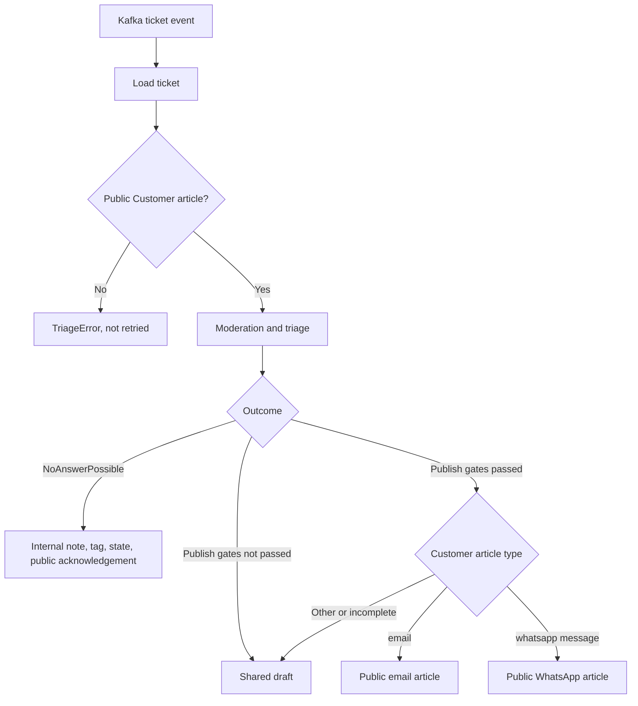

# Channel-Aware Replies

A public reply must go back through the channel the customer used. A bare Zammad article is stored as a `note`, which is visible in the ticket but never reaches the customer. The standard REST client therefore builds a channel-specific article for each reply.

## Flow

Kafka is the only ticket-event ingress. Events carry the ticket ID but no article ID, so the workflow loads the ticket and selects the newest public `Customer` article with `ZammadTicket.latest_customer_article()`. Triage reads that article, and the reply channel is resolved from the same selection when the answer is posted.

## Publish Gates

An answer is published only when both gates pass:

1. The triage category has `auto_publish: true`.
2. The answer is a `StaticAnswer`, or an `AnswerCandidate` with `auto_publish` set. Judge rejection and an unsafe response moderation result clear that flag.

Every other answer becomes a shared draft for an agent to review.

## Reply Payloads

| Customer article type | Article created | Addressing |
| --- | --- | --- |
| `email` | `type=email`, `sender=Agent`, `internal=false` | `from` and `to` are reversed from the customer article; `in_reply_to` uses its message ID |
| `whatsapp message` | `type=whatsapp message`, `sender=Agent`, `internal=false`, `text/plain` | None. Zammad reads the recipient from `ticket.preferences['whatsapp']['from']['phone_number']` |
| Anything else, or an email without a customer address | Shared draft | The system never substitutes another channel |

Creating an article means Zammad accepted it. It does not prove delivery by the mail server or Meta.

## Handoff

`NoAnswerPossible` runs a handoff that surfaces the ticket to agents and tells the customer it was received. The `human_review_*` settings apply when the category is the `no_category_name` or the action is `NoAction`. The `no_answer_*` settings apply otherwise.

1. Post the internal note (`human_review_internal_note` or `no_answer_internal_note`).
2. Add the tag (`human_review_tag` or `no_answer_tag`).
3. Set `handoff_ticket_state`, when configured.
4. Post the localized public acknowledgement (`human_review_public_fallback` or `no_answer_public_fallback`).

## Known Limits

- **Duplicates:** there is no durable idempotency. A redelivered Kafka message can create a second reply.
- **Delivery status:** the workflow does not check whether Zammad delivered the article.
- **Queued messages:** the event does not identify an article, so two messages queued closely together both resolve to the newest one.
- **EAI client:** only the standard REST client implements channel replies.
